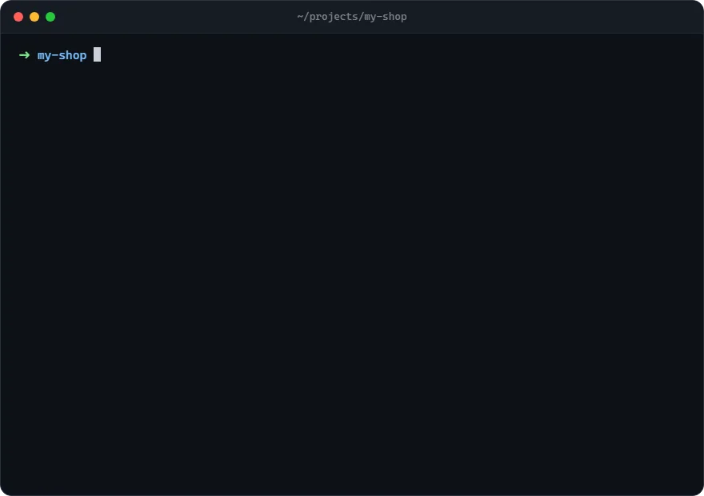

<div align="center">

# ai-kit

**One setup for every AI coding agent.**

One command gives any project the same rules, docs and proven prompts, so Claude Code, Gemini / Antigravity,
Codex and Cursor all work the same careful way, from the first session.

[](https://hazman97.github.io/ai-kit/)
[](LICENSE)




</div>

## Quick start

Inside your project folder:

```bash
npx github:Hazman97/ai-kit init
```

Then tell your AI agent:

```text
follow .ai/prompts/project-setup.md
```

That's it: your agent fills `docs/PROJECT.md` from the code, and every agent now follows the same rules.
No install and no dependencies; Node.js 18+ is enough. **Full guide with examples:
[hazman97.github.io/ai-kit](https://hazman97.github.io/ai-kit/)**

## What you get

```
your-project/
├── AGENTS.md            ← the rules every agent follows (one source for all of them)
├── CLAUDE.md            ← "@AGENTS.md" (Claude Code reads AGENTS.md through it)
├── GEMINI.md            ← "@./AGENTS.md" (Gemini CLI / Antigravity too)
├── LEARNINGS.md         ← mistakes worth remembering; agents add entries only with your OK
├── docs/
│   └── PROJECT.md       ← the one base doc: what it is, stack, commands (filled for you), structure
└── .ai/
    ├── ai-kit.json      ← version + what was detected
    └── prompts/         ← tools for bigger jobs, used when you ask for them
        ├── project-setup.md   fill docs/PROJECT.md from the code
        ├── docs-update.md     sync docs with code (update only, verify every claim)
        ├── frontend-setup.md  write docs/FRONTEND.md (design tokens, Tailwind rules, phone rules)
        ├── ui-task.md         hand UI work to another agent: logic first, look second, screenshots as proof
        └── audit.md           a production-safe audit: static + API contract + running the app
```

### The ideas behind it
- **Few docs, always true.** One base doc (`docs/PROJECT.md`). Other docs (`API`, `DATABASE`, `FRONTEND`,
  `OPS`) are created only when the project needs them. The Docs Index in `AGENTS.md` lists only files that
  exist, so agents never chase a doc that is not there.
- **Rules that hold up:** verify before saying "done", fix root causes, never commit or run destructive
  commands without asking, secrets never in code, phone-width and light/dark checks for every screen.
- **Your text is yours.** ai-kit only changes its own marked blocks. Everything else (your Project notes,
  `LEARNINGS.md`, `docs/PROJECT.md`, prompts you edited) is never overwritten.

## Commands

Run them inside the project folder (or pass `--dir <path>`).

| Command | What it does |
|---|---|
| `npx github:Hazman97/ai-kit init` | Detects the stack in the root **and every sub-folder with its own manifest** (a `frontend/` + `backend/` repo, `apps/*` workspaces, a Python or Go API next to a React app…), labels each part frontend / backend / fullstack / mobile, and adds the files above. Existing files are kept; `.gitignore` gets a small ai-kit block so agent scratch files (screenshots, browser profiles) are never committed. |
| `npx github:Hazman97/ai-kit init` (again, or on a project that already has an `AGENTS.md`) | Brings it to the latest version: an ai-kit `AGENTS.md` gets the newest rules; any other `AGENTS.md` / `CLAUDE.md` / `GEMINI.md` is backed up to `.ai/backup/`, gets the rules and the import line, and keeps its own sections and Docs Index texts. `--no-merge` leaves them untouched. |
| `npx github:Hazman97/ai-kit update` | Newer rules and prompts from this repo. Your notes and your own prompts are not touched. |
| `npx github:Hazman97/ai-kit doctor` | Checks: docs referenced but missing, unfilled placeholders, old doc names, a stale Docs Index, agents that do not read AGENTS.md, a long LEARNINGS.md, and **`.env` files committed to git**. Exit code 1 on errors (handy in CI). |
| `npx github:Hazman97/ai-kit doctor --fix` | Also regenerates the Docs Index. |

Add `--dry-run` to any command to see what would change without changing anything.

## After `init`

Open the project with your agent and say:

1. `follow .ai/prompts/project-setup.md` → it fills `docs/PROJECT.md` from the code.
2. For a project with a UI: `follow .ai/prompts/frontend-setup.md` → it writes `docs/FRONTEND.md`.
3. Commit the new files.

Later: `follow .ai/prompts/audit.md` before a release, `follow .ai/prompts/ui-task.md` to hand a screen to
another agent, and "update the docs" whenever the code moved on.

## Customising

- **Project-specific rules:** write them under `## Project notes` in `AGENTS.md`.
- **Your own version of a prompt:** delete its first line (`<!-- ai-kit:managed … -->`); `update` will leave
  it alone from then on.
- **Personal rules for every project** (language, tone): put them in your agent's global file instead
  (`~/.claude/CLAUDE.md`, `~/.gemini/GEMINI.md`, `~/.codex/AGENTS.md`).
- **Your own kit:** fork this repo, edit `templates/`, and use `npx github:<you>/ai-kit init`.

---

## Ringkas (Bahasa Melayu)

Buka terminal dalam folder projek, kemudian:

```bash
npx github:Hazman97/ai-kit init      # pasang (fail sedia ada tak ditindih)
npx github:Hazman97/ai-kit doctor    # semak: docs hilang, placeholder, .env dalam git
npx github:Hazman97/ai-kit update    # tarik peraturan terbaru (nota projek tak disentuh)
```

Lepas `init`, beritahu AI: **"follow .ai/prompts/project-setup.md"**. Dia akan isi `docs/PROJECT.md` dari kod.
Projek yang dah ada `AGENTS.md`? Jalankan `init` macam biasa: peraturan terbaru dimasukkan, nota projek anda dikekalkan, dan backup disimpan dalam `.ai/backup/`. Guna `--no-merge` kalau tak nak fail itu diubah.

## Develop

```bash
npm test                      # node:test, no dependencies
node bin/ai-kit.js init --dir ../some-project --dry-run
```

- The website is `docs/index.html` (plain HTML, served by GitHub Pages from `/docs`).
- The demo animation `docs/assets/demo.webp` is made from `scripts/demo-terminal.html`: a headless browser
  calls `render(t)` for each frame and screenshots it, then
  `ffmpeg -framerate 12 -i f%04d.png -c:v libwebp_anim -q:v 82 -loop 0 demo.webp`.

MIT licence.
